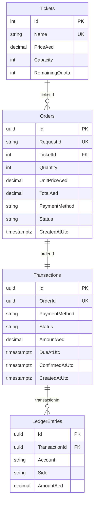

# Ticketing

ASP.NET Core 8 + PostgreSQL + React demo for e-ticketing checkout. One Compose command starts the API, database, and browser UI. Buy tickets with a simulated **Card** (immediate) or **QR** (confirms about eight seconds later). Quota reservation, payment status, and ledger posting stay consistent under retries and restarts.

## Prerequisites

- Docker Desktop or Docker Engine with Compose
- Optional for local tests: .NET 8 SDK

## Five-minute setup

```sh
docker compose up --build -d
```

| Surface | URL |
| --- | --- |
| Browser UI | http://localhost:5173 |
| Catalog API | http://localhost:5080/api/tickets |
| Orders API | http://localhost:5080/api/orders |

Open the UI, pick Gold / quantity `2` / Card, and buy. Expect **AED 200**, Gold remaining **98**, and a receipt with transaction ID plus UTC confirmation time. QR shows pending immediately, then succeeds after the worker confirms.

## Catalog (demo quotas)

| Ticket | Price (AED) | Initial quota |
| --- | ---: | ---: |
| Gold | 100 | 100 (required by brief) |
| Premium | 200 | 100 (demo assumption) |
| VIP | 500 | 100 (demo assumption) |

## Sample API purchase

```sh
curl -s -X POST http://127.0.0.1:5080/api/orders \
  -H "Content-Type: application/json" \
  -d "{\"requestId\":\"demo-card-1\",\"ticketId\":1,\"quantity\":2,\"paymentMethod\":\"Card\"}"
```

QR returns HTTP 202 with `status: Pending`. Poll `GET /api/orders/{id}` until `Succeeded`.

## Tests

With Compose `db` running (port `55432`):

```sh
dotnet restore
dotnet build --no-restore
dotnet test --no-build
```

Tests use database `ticketing_tests` on the same Postgres instance. Override with `TICKETING_TEST_DB`. GitHub Actions runs the same commands against a Postgres service on every push and pull request (see `.github/workflows/ci.yml`).

## Data model



Cardinalities: one ticket type has many orders; each order has exactly one payment transaction; each successful transaction has two ledger rows (one Debit, one Credit), enforced by a unique `(TransactionId, Side)` index.

## Crash recovery and money movement

1. **Quota reservation** happens inside the checkout database transaction with a conditional update (`RemainingQuota >= quantity`). If the update affects zero rows, the buyer gets HTTP 409 and no order/payment/ledger rows are kept.
2. **Card** posts the order, succeeded payment, and balanced ledger (Debit `Cash/Payment Gateway`, Credit `Ticket Sales Revenue`) in that same commit.
3. **QR** commits reserved quota, a pending order, and a pending payment with `DueAtUtc = now + 8s` together — **no ledger yet**. HTTP 202 returns immediately. A background worker polls due payments, claims a still-pending row in a short transaction, then marks order/payment succeeded and inserts the two ledger rows.
4. **Crash before commit**: nothing is visible; the client may retry with the same `requestId`.
5. **Crash after QR pending commit, before confirmation**: quota stays reserved; on API restart the worker resumes and confirms once when due. A second confirmation attempt is a no-op.
6. **Idempotency**: replaying the same `requestId` with the same inputs returns the existing order without reserving again. Different inputs with the same `requestId` return HTTP 409.

## Develop

```sh
dotnet tool restore
dotnet ef migrations add <Name> --project src/Ticketing.Api --output-dir Data/Migrations
```

Frontend: `web/` (React + TypeScript + Vite). Production image is served by nginx in Compose.
